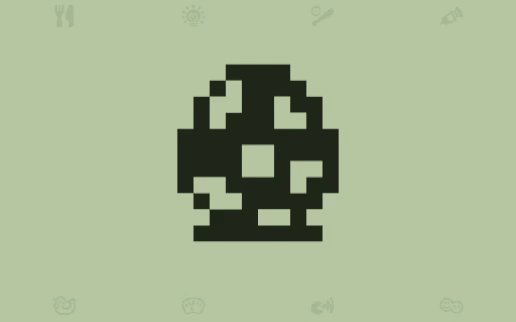
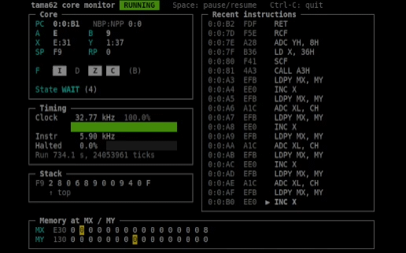

# tama62

**An emulator for the original Tamagotchi digital pet**



## Overview

The original Tamagotchi was an incredibly simple yet addictive toy. Its specs are very modest, even for the mid 90's:

- **Processor:** 4-bit CMOS E0C6S46 CPU @ 32.768 kHz
- **Program Memory:** 6,144 x 12-bit words ROM
- **Data Memory:** 640 x 4-bit words RAM
- **Display:** Monochrome 32x20 LCD w/ 160 x 4-bit words

## Emulator Progress

- [x] E0C6200 CPU Emulator
- [x] 32.768 kHz Program Runner
- [x] Timers
- [x] Interrupts
- [x] LCD Display
- [ ] Input Ports
- [ ] Sound Generator
- [x] TUI-style Monitor

## Building

Requires a C++20 compiler (GCC or Clang) and `make`:

```sh
make
```

## Running

This repository does **not** include the Tamagotchi ROM. You need to supply your own dump, named `tama.bin`, in the directory you run the emulator from.

```sh
./tama            # run the emulator
./tama --monitor  # show a live CPU core monitor in the terminal (or -m)
```

The monitor shows registers, flags, run state, clock and instruction rates, the stack, memory at MX/MY and the most recent instructions. It needs a terminal at least 80 columns wide. Press **Space** (or **P**) in the terminal to pause the emulator, and again to resume.



Press **Ctrl-C** to stop.

## References

- [E0C6S46 Technical Manual](https://download.epson-europe.com/pub/electronics-de/asmic/4bit/62family/technicalmanual/tm_6s46.pdf)
- [The Tamagotchi Project](https://cctp506m.github.io/tamagotchi/architecture/)

## License

The emulator source code is released under the [MIT License](LICENSE). This does not cover any ROM image.

## Disclaimer

Tamagotchi is a trademark of Bandai. This project is not affiliated with or endorsed by Bandai.
